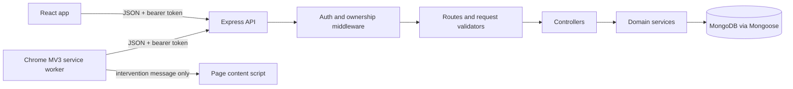

# Architecture

RESTIFY is a modular single-page web application backed by an Express/Mongoose API. The browser
extension is optional and communicates with the same API; it is not required for web-app
tracking or focus sessions.

## Components

The API authenticates each bearer token, loads the corresponding current user, then applies
resource ownership checks in service queries. Administrator routes additionally check the stored
user role on the server. Browser pages and extension content scripts are not authorization
boundaries.

## Source layout

- `frontend/src/App.jsx`: public, protected, focus, and admin routes.
- `frontend/src/context/`: authentication and persisted preference state.
- `frontend/src/services/`: API clients; web bearer token uses the `restify.auth.token`
  localStorage key.
- `frontend/src/pages/` and `components/`: dashboard, rule builder, focus, admin, notifications.
- `backend/src/app.js`: Express configuration, health endpoint, route mounting, error handler.
- `backend/src/routes/`: HTTP route declarations and middleware order.
- `backend/src/controllers/`: HTTP request/response adaptation.
- `backend/src/services/`: domain logic and user-scoped database operations.
- `backend/src/models/`: Mongoose schemas and indexes.
- `backend/src/middleware/`: authentication, admin gate, rate limit, and error handling.
- `browser-extension/background.js`: service worker, API requests, browser tab/session tracking.
- `browser-extension/content.js`: in-page intervention/rest display; does not receive tokens.

## Request flow and errors

1. Express parses JSON requests (10 KB maximum), applies configured CORS, and routes `/api/*`.
2. Private routes verify bearer-token signature/issuer/audience/expiry and token version.
3. Validators reject malformed bodies/IDs and unsupported fields before service work.
4. Services apply the authenticated user ID to private record queries and enforce state transitions.
5. Controllers return a consistent JSON envelope; centralized error middleware maps validation,
   malformed ID, duplicate-key, oversized-body, and unexpected errors to safe responses.

The health route reports MongoDB connection state. Server logs report error names rather than
request secrets or raw Mongo connection values.

## Authentication and logout

Passwords are bcrypt-hashed. JWTs are signed with `JWT_SECRET`, default to a one-hour lifetime
(`JWT_EXPIRES_IN`), and contain a subject, issuer/audience, expiry, and token version. The
`tokenVersion` field is hidden by default and excluded from serialized user objects. Auth
middleware compares the token's version to the user's current database value. Logout increments
the account version, invalidating existing tokens for that account; the next sign-in issues a
token with the new version.

The web app stores its bearer token in localStorage. The extension stores its token in Chrome
extension-local storage restricted to trusted extension contexts; the content script receives
only intervention display data.

## Tracking and analytics

Session start optionally snapshots an owned enabled rule so later rule changes do not rewrite the
session's settings. The backend stores server timestamps, whole-second active duration, pause
history, and state. A unique sparse index on `activeOwner` limits a user to one open session.
Analytics combine completed and currently active tracked intervals where appropriate, subtract
overlaps, and group daily buckets by UTC. Admin session totals intentionally count completed
session documents only.

## Browser extension boundaries

The Manifest V3 service worker observes the focused active HTTP(S) tab and browser idle state,
fetches the user's enabled rules, and starts/ends sessions through authenticated API calls. At a
rule limit it asks the backend to pause into configured rest and displays a browser-page reminder.
Restricted pages, other browsers, native apps, and mobile apps are outside its scope. See the
[extension guide](../browser-extension/README.md).
